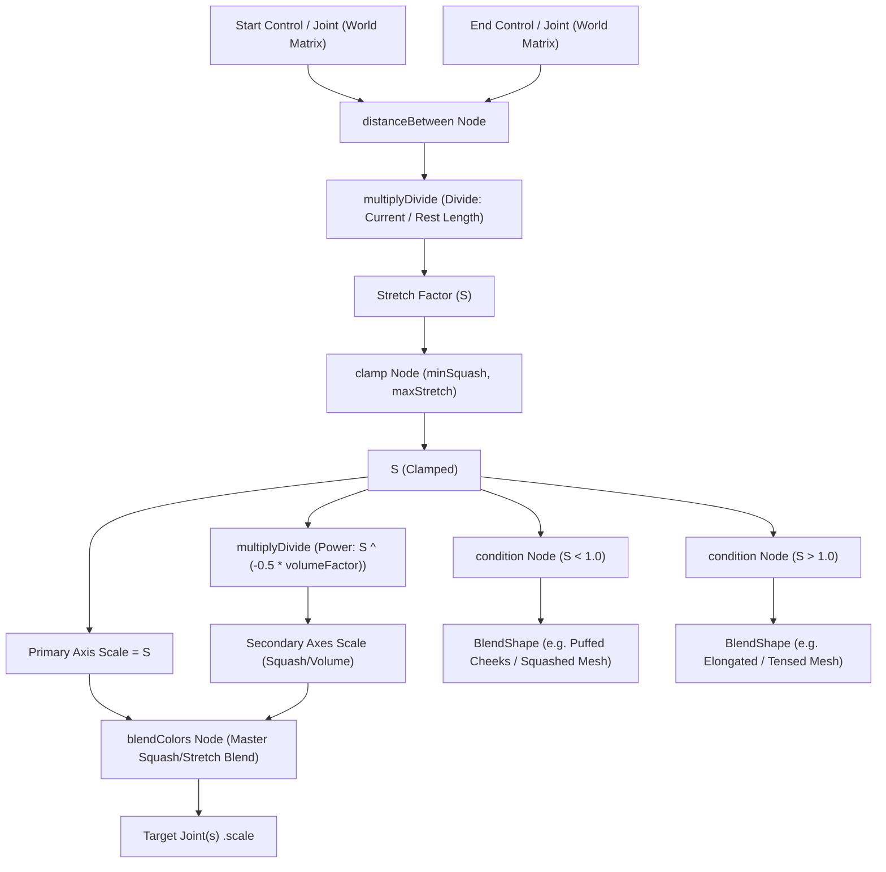

# Research Project 1: Maya Squash & Stretch Rigging Tool

## 1. Project Overview & Scope
- **Goal:** Build an automated, modular Squash & Stretch rigging tool in Autodesk Maya (Python 3 / `maya.cmds` / OpenMaya / PySide) with volume preservation, blendshape drivers, preset saving/loading, and cross-character compatibility.
- **Instructor Feedback Addressed:** The instructor requested verifying that the tool is **not character-specific** and works across multiple rigs. The tool will be completely agnostic of character topology and joint naming conventions by relying on dynamic selection, axis detection, and modular node construction.

---

## 2. Milestone Roadmap

| Milestone | Target Date | Deliverable |
| :--- | :--- | :--- |
| **Week 1** | **Nov 10 (Today)** | **Core rigging engine:** Automated volume-preserving node network generation on any 2-point or N-joint chain, selectable stretch axis, volume factor slider, cycle-free distance calculation, undo/removal system, and a 1-click test rig generator. |
| **Week 2** | **Nov 17** | **Blendshape & Presets:** Bidirectional blendshape drivers (squash delta $\to$ squash shape, stretch delta $\to$ stretch shape), JSON preset serialization (Character, Bouncy/Rubber, Subtle, Hard-Surface). |
| **Week 3** | **Nov 23** | **Polished UI & Integration:** PySide/Qt interface, multi-character demonstration scene, presentation clip / playblast setup. |
| **Class Demo** | **Nov 24** | **In-Class Presentation** |

---

## 3. Mathematical & Node Architecture

### Volume Preservation Math
To preserve 3D volume ($V = S_x \cdot S_y \cdot S_z = 1.0$):
- If stretching along primary axis $X$ by factor $S$:
  $$S_x = S$$
- For uniform cross-section ($S_y = S_z$):
  $$S_y \cdot S_z = \frac{1}{S} \implies S_y = S_z = \frac{1}{\sqrt{S}} = S^{-0.5}$$
- Introducing animator-controlled `volumeFactor` ($k \ge 0$, default $1.0$):
  $$S_{\text{secondary}} = S^{-0.5 \cdot k}$$
  - $k = 0$: No cross-axial change (mechanical stretch).
  - $k = 1.0$: Exact mathematical volume preservation.
  - $k > 1.0$: Exaggerated cartoon squash.

---

## 4. Multi-Character Modularity Strategy
To satisfy the instructor's requirement without breaking on different characters:
1. **Zero Hardcoded Names:** Uses Maya selection (Start Transform, End Transform, Target Joints).
2. **Configurable Primary Axis:** Supports X, Y, or Z (different auto-riggers like AdvancedSkeleton, HumanIK, and mGear use different primary bone axes).
3. **Clean Deconstruction / Removal:** Every generated setup tags nodes with a meta-network node (`SS_MetaNode`), allowing one-click safe deletion without breaking existing rig hierarchies or leaving junk nodes.
4. **Cycle Prevention:** Uses `worldMatrix[0]` decomposed via `decomposeMatrix` or `pointMatrixMult` to drive `distanceBetween`, preventing Maya parent-child DAG cycle warnings.

---

## 5. Today's Plan (Nov 10 Deliverable)
1. Build `squash_stretch.py` with:
   - `build_squash_stretch()`: The core node builder.
   - `remove_squash_stretch()`: Safe cleanup.
   - `create_test_rig()`: Generates a sample stylized cartoon character / limb test scene with geometry in Maya so you can verify immediately live.
2. Send commands through the active bridge (`port 54321`) to test directly inside your open Maya session.
